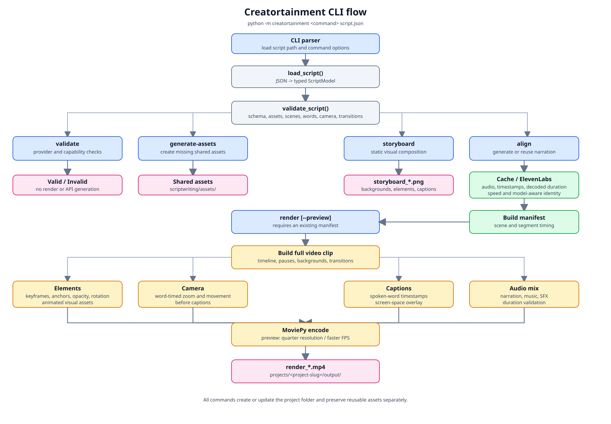

# Creatortainment

Creatortainment turns an authored JSON script into a finished 
video. It combines scenes, narration, reusable visual and audio assets,
captions, camera motion, transitions, music, and sound effects into a
MoviePy/FFmpeg rendering pipeline.

The intended workflow is:

```text
author or describe a script
        ↓
validate the script and assets
        ↓
generate a storyboard
        ↓
generate or reuse aligned narration
        ↓
render a preview
        ↓
iterate
        ↓
render the final video
```

---

## Choose a workflow

### Recommended: use an AI coding agent

For the easiest experience, use an agent such as GitHub Copilot, Claude Code,
or Gemini CLI in the local `scriptwriting/` workspace. The workspace gives
the agent the conventions, asset indexes, script lifecycle, and reusable
`agent_knowledge/` needed to create and improve scripts.

An agent can:

- read and maintain preferences in `agent_knowledge/`
- organize assets added to `scriptwriting/assets/`
- create asset sidecars and descriptions
- build scripts in `scriptwriting/scripts/drafts/`
- move completed or superseded scripts to `archive/`
- run validation and storyboard commands
- prepare narration alignment and previews
- explain missing assets and next steps
- preserve confirmed user preferences across future sessions

The agent should not make a full paid render or narration/API call unless you
explicitly request it. Keep provider credentials local and review any
generation step that spends credits.

### Direct: use the CLI

Use the CLI directly when you prefer explicit control, are automating scripts,
or are developing Creatortainment itself. Every agent workflow ultimately uses
the same local commands documented below.

---

## Render the working example

Clone the repository, install the full dependencies, and run the committed
example preview:

```bash
git clone https://github.com/Michago6/creatortainment.git
cd creatortainment
python3 -m venv .venv
.venv/bin/python -m pip install -e '.[full]'

.venv/bin/python -m creatortainment render \
  testing/scripts/creatortainment_example.json \
  --preview \
  --assets-root testing/assets \
  --manifest testing/fixtures/manifests/creatortainment_example.json \
  --out "$PWD/testing/output/creatortainment_example_preview.mp4"
```

No ElevenLabs or fal.ai API key is needed. The example uses a committed 18.76
second narration MP3 and matching alignment manifest, plus committed images,
sprites, SFX and music. It does not regenerate narration or download assets.

When the command finishes, open:

```text
testing/output/creatortainment_example_preview.mp4
```

The `testing/output/` directory is created automatically and generated videos
are ignored by Git.

---

## Agent-assisted quick start

### 1. Create the environment

```bash
python3 -m venv .venv
.venv/bin/python -m pip install -e '.[full]'
cp .env.example .env
```

Add provider credentials to `.env` only when you need them:

```text
ELEVENLABS_API_KEY=...
FAL_KEY=...
```

Never commit `.env` or API key files.

For ElevenLabs voice validation, the API key needs the `voices_read`
permission. Community/shared voices may need to be added to **My Voices**
before being able to be used.

### 2. Discover and organize reusable assets

Place reusable images, videos, music, and sound effects under
`scriptwriting/assets/`. Organize them by category manually or let an AI agent do it, for example:

```text
scriptwriting/assets/
├── backgrounds/
├── images/
├── audio/
│   ├── music/
│   └── sfx/
└── fonts/
```

To create or refresh the local curated inventory, sidecars, and asset indexes:

```bash
.venv/bin/python tools/bootstrap_scriptwriting_assets.py --inspect-frames
```

Assets are normally shared across projects. Scripts reference them through the
`asset_registry` using stable keys and `assets/...` paths, not absolute local
paths.

### 3. Start an agent in the workspace

For GitHub Copilot CLI:

```bash
cd scriptwriting
copilot
```

For another coding agent, open a session in `scriptwriting/` and tell it to
read `AGENTS.md`, `ASSET_INDEX.md`, `docs/`, and `agent_knowledge/INDEX.md`.
The workspace can work with agents that support repository instructions and
local files.

Example prompts:

```text
Create a 30-second short-form script about retro video games.
Use the assets in the asset library and my saved writing preferences.
Render a preview when the script is finished.
```

```text
Organize these newly added assets, describe what they contain,
update the asset index, and create an asset sidecar for each one.
```

```text
Create a storyboard for the draft and point out missing assets.
Do not generate narration or render the full video.
```

```text
Describe visual aspects of scenes and missing assets to create a
video following the drafted storyline.
Do not generate narration or render the full video.
```

### 4. Reuse learned preferences

At the start of a script project, the scriptwriting agent reads
`agent_knowledge/INDEX.md`, then only the knowledge files relevant to the
request.

Reusable preferences may be stored in `agent_knowledge/` for:

- writing style
- preferred captions
- common shot and camera patterns
- editing and transition preferences
- asset naming conventions
- voice and narration choices
- confirmed workflow lessons

Knowledge is supplementary. Current user instructions and the schema/documented
conventions always take precedence. Only confirmed, reusable preferences should
be written there.

---

## Direct CLI quick start

The repository includes a short, cached GPU-explanation example in
`testing/` that uses only committed test assets and narration:

```text
testing/scripts/creatortainment_example.json
```

It can be rendered without provider API keys or a private scriptwriting
workspace:

```bash
.venv/bin/python -m creatortainment render \
  testing/scripts/creatortainment_example.json \
  --preview \
  --assets-root testing/assets \
  --manifest testing/fixtures/manifests/creatortainment_example.json \
  --out "$PWD/testing/output/creatortainment_example_preview.mp4"
```

The preview is written to `testing/output/creatortainment_example_preview.mp4`.
Open that MP4 with a media player to watch the complete example.

The working example is the quickest way to verify a fresh clone: it uses
committed image, sprite, narration, SFX and music fixtures, and does not call
ElevenLabs or fal.ai.

The normal script lifecycle for local authoring is:

```text
scriptwriting/drafts/ -> scriptwriting/archive/
```

### 1. Validate

Validation checks the Pydantic script model, asset registry, asset files,
word indexes, keyframes, captions, transitions, and provider configuration.

```bash
.venv/bin/python -m creatortainment validate <script.json>
```

If a script references a missing asset with a `generate` property, use the
`--asset-gen-info` flag with `validate` to preview exactly what the
`generate-assets` command would generate. It shows the effective provider
model for each missing asset and reports how each asset's generation method
and model are resolved:

```bash
.venv/bin/python -m creatortainment validate \
  <script.json> \
  --asset-gen-info
```

### 2. Generate missing assets

Use this only when the script contains supported `generate` blocks and provider
credentials are configured:

```bash
.venv/bin/python -m creatortainment generate-assets <script.json>
```

Existing assets are skipped unless `--force` is provided.

### 3. Create a storyboard

```bash
.venv/bin/python -m creatortainment storyboard <script.json>
```

The storyboard verifies scene composition and rough caption placement without
running full narration or video generation. Use `--out` to choose a project
relative filename.

### 4. Generate or reuse narration

> [!WARNING]
> This step calls the ElevenLabs API when new narration is required and will
> consume ElevenLabs credits. 
```bash
.venv/bin/python -m creatortainment align <script.json>
```

This creates or reuses the narration audio and alignment manifest. Creatortainment
normally reuses matching cached narration and asks before replacing it when a
narration change requires a new take.

Useful flags:

- `--force-audio` — create a new narration take without confirmation
- `--debug` — write diagnostics to the project folder

### 5. Render a preview

```bash
.venv/bin/python -m creatortainment render \
  <script.json> \
  --preview \
  --out output/preview.mp4
```

Preview rendering uses quarter resolution and faster encoding. Review timing,
captions, assets, movement, narration, transitions, and scene boundaries before
performing a full render.

### 6. Render the final video

```bash
.venv/bin/python -m creatortainment render \
  <script.json> \
  --out output/final.mp4
```

Output paths are relative to the project directory.

---

## CLI reference

### Commands

| Command | Purpose |
|---|---|
| `validate` | Validate the script model, assets, timing, captions, and provider metadata |
| `generate-assets` | Generate missing assets declared by the script |
| `storyboard` | Create a static project-wide composition preview |
| `align` | Generate or reuse narration and alignment data |
| `render` | Build and encode a preview or full-resolution MP4 |

### Command help

```bash
.venv/bin/python -m creatortainment --help
.venv/bin/python -m creatortainment validate --help
.venv/bin/python -m creatortainment generate-assets --help
.venv/bin/python -m creatortainment align --help
.venv/bin/python -m creatortainment storyboard --help
.venv/bin/python -m creatortainment render --help
```

### CLI architecture

The complete flow, including asset resolution, validation, narration caching,
storyboards, scene construction, transitions, audio mixing, and encoding:



[Open the CLI flow diagram at full size](docs/creatortainment-cli-flow.svg)

---

## Projects and assets

### Shared assets

Reusable assets live once in `scriptwriting/assets/` and can be used by every
project.

```json
"bg_studio": {
  "path": "assets/backgrounds/default_studio.jpg",
  "generate": null
}
```

The `generate` field may describe an asset that should be created by a
provider. A missing file is allowed only if a non-null `generate` block can
produce it.

Never put raw absolute filesystem paths in the script. Use asset registry keys
and project-relative `assets/...` paths.

### Project output

Projects use a stable title-based folder under `projects/`:

```text
projects/creatortainment_example/
├── script.json
├── project_state.json
├── build_manifest.json
├── build_manifests/
├── narrations/
├── storyboard_YYYYMMDD_HHMMSS.png
└── output/
    ├── render_YYYYMMDD_HHMMSS_preview.mp4
    └── render_YYYYMMDD_HHMMSS.mp4
```

The project script copy, narration cache, alignment manifest, storyboards, and
renders belong there. Project folders do not own reusable assets.

---

## Editing scripts

The main authoring file is JSON. Important sections include:

- `project.resolution` and `project.fps`
- `project.caption_style`
- `scene.caption_style`
- `scene.elements` and keyframes
- `scene.pause_before_sec`
- `scene.transition_in`
- `scene.bg_music`
- `scene.sfx`
- `project.duck_to_narration_pct`
- narration text and optional narration segments

For the complete authoring rules, start with:

- [`scriptwriting_template/docs/SCRIPT_STRUCTURE.md`](scriptwriting_template/docs/SCRIPT_STRUCTURE.md)
- [`scriptwriting_template/docs/SCRIPT_CONVENTIONS.md`](scriptwriting_template/docs/SCRIPT_CONVENTIONS.md)
- [`scriptwriting_template/docs/WRITING_GUIDELINES.md`](scriptwriting_template/docs/WRITING_GUIDELINES.md)
- [`scriptwriting_template/docs/ASSET_LIBRARY_GUIDELINES.md`](scriptwriting_template/docs/ASSET_LIBRARY_GUIDELINES.md)

---

## Running tests

The test suite is designed to work offline and mock provider lookups. It should
not call ElevenLabs or fal.ai or spend API credits:

```bash
.venv/bin/python -m pytest
```

Tests cover:

- typed script schema and validation
- asset registry and missing assets
- narration caching and alignment
- scene boundaries and captions
- text and image elements
- keyframes, anchors, camera motion, and z-order
- CFR and VFR video timing
- transitions and timeline mapping
- music and SFX mixing
- storyboard and CLI rendering paths

---

## Contribute to Creatortainment

Feel free to try it out and report any issues you run into. You can make pull
requests or just reach out if you want to connect.

`scriptwriting/` and `projects/` are gitignored working areas. Changes to
public agent behavior should normally go in `scriptwriting_template/`;
repository implementation changes go in `creatortainment/`.

API credentials are optional for offline schema and rendering tests. Do not
include secrets in fixtures, logs, debug output, screenshots, or test files.

### Reporting bugs or requesting features

[Open a GitHub issue](https://github.com/Michago6/creatortainment/issues) preferably with:

- the exact command or workflow used
- the relevant script or a minimal reproduction
- OS, Python, FFmpeg, and MoviePy versions
- source asset metadata when playback or VFR timing is involved
- expected behavior
- actual behavior
- screenshots or a short terminal/video sample if relevant
- the shortest useful log excerpt

Remove secrets and private asset URLs before posting. If possible, attach or
describe a small offline fixture that reproduces the issue without ElevenLabs
or fal.ai API calls.

For playback-speed regressions, include source and output duration, FPS/PTS
metadata, recognizable frame positions, and whether the affected asset is CFR
or VFR.

For narration or scene-boundary regressions, include:

- source narration audio
- alignment timestamps
- scene IDs
- the scene boundary
- whether a transition is present
- a short clip demonstrating the problem

---

## Troubleshooting

### A referenced asset is missing

Add or generate the file at the exact `asset_registry` path under
`scriptwriting/assets/`, then validate again.

### Narration will not align or voice validation fails

Check `.env`, the ElevenLabs voice ID, model support, and the API key's
`voices_read` permission.

### No build manifest exists

Run `align` before `render`. A project may contain cached narration in
`narrations/`, but it still needs the matching build manifest.

### Output is not visible immediately

Scene construction, audio mixing, and encoding have separate progress stages.
Full-resolution portrait renders can take substantially longer than previews.

### Existing outputs are not overwritten

Creatortainment selects a timestamped alternative name when a storyboard or
render destination already exists. Use `--out` to choose a project-relative
name.

## A small piece of advice

Do not wait for the full render to discover that an element is slightly too
far left or a caption is too low. The storyboard catches composition issues;
the preview catches timing and audio issues; the final render is for producing
the polished result. That workflow keeps the creative process quick,
repeatable, and much less stressful. 🚀
